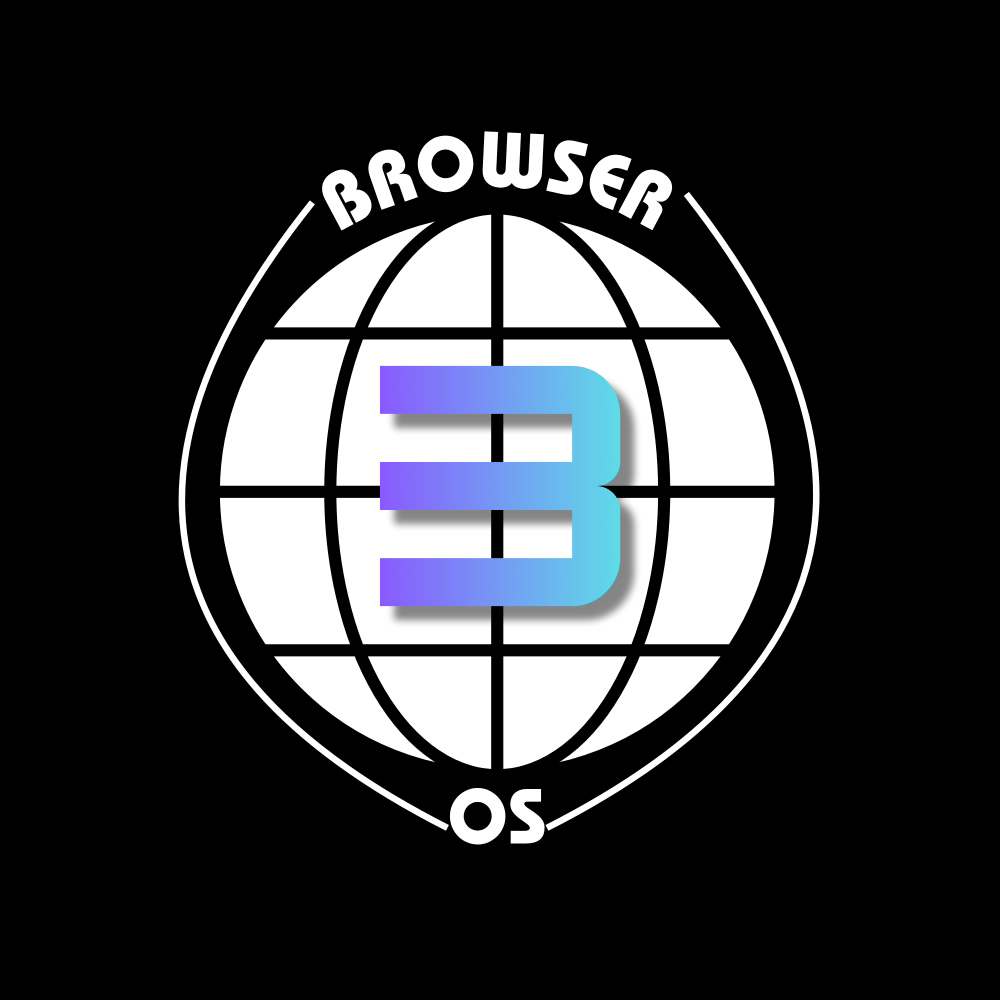

# BrowserOS

**Your desktop, in a browser tab.** Open apps, make things, organize your files, and make the desktop your own.

[Main site](https://jg-tech-aosp.github.io/browseros/) · [Development preview](https://jg-tech-aosp.github.io/browseros3dev/) · [What’s new in 3.0.0](docs/release-3.md)

## A little desktop with a lot to do

- **Make it yours with Clear Ice.** Choose light or dark, adjust the glass blur and tint, pick a matching wallpaper, or use a picture already in your BrowserOS files. Add desktop widgets for supported native apps.
- **Find your flow.** Snap windows into halves or quarters, switch apps from the keyboard, and return to a window through taskbar previews. Running apps share their pinned buttons.
- **Keep your files in order.** Import files, drag them between folders and the Desktop, choose default apps with Open with, and recover deleted items from Recycle Bin.
- **Bring everyday tools along.** Calendar, Clock and Video Player join Paint, Image Viewer, Music Player, Text Editor, Browser, Terminal and System Monitor. Click the taskbar time and date for a compact calendar and clock panel.
- **Add more apps.** Install `.beep` packages from the App Store, check for updates, or sideload a package. Writer, Stage and Cells cover documents, presentations and spreadsheets; Snake and BrowserBricks cover your breaks.
- **Keep a backup.** Export a single file or download a profile ZIP containing files, settings, installed apps, permissions and supported app data. Restore by merging or replacing a profile.

Version **3.0.0** is prepared in this development repository. The main-site rollout happens separately; the main site may still serve the previous release until then.

## Get started

1. Open the site in a current browser with JavaScript and IndexedDB enabled. There is no desktop installer.
2. Choose a local profile name and a light or dark theme during first-run setup.
3. Click the taskbar logo to open Start. Open **Help** for the shortcut manual, or **Info** for a tour.
4. Open **File Manager → Import** to copy files from your computer into BrowserOS.
5. Visit **Settings** to customize the desktop, manage apps and permissions, or create a backup.

| Shortcut | Action |
| --- | --- |
| Ctrl + Space | Open or close Search |
| Ctrl + Shift + Space | Open the app switcher |
| Tab / Shift + Tab or arrow keys | Move through the app switcher |
| Enter / Escape | Confirm a selection / dismiss the panel |

Inside a `.beep` app, move focus away from text fields before invoking the app switcher. Your browser or operating system may reserve other shortcuts. Terminal’s `help` command lists its commands and controls.

## Your files and your browser

BrowserOS stores its virtual files, installed apps, settings and supported app data locally in the current browser profile. They are separate from your computer’s ordinary folders and do not automatically sync between browsers or devices. Clearing site data can erase them. Keep downloaded backups outside BrowserOS.

First-run profiles are local personalization, not online accounts or password-protected logins. Anyone using the same browser profile may be able to open its saved files. **Reset Filesystem is a factory reset**: it removes the profile, files, apps, app data and settings.

The development preview and main site currently use separate profile databases. Do not assume files will appear on both; use backups when moving between them.

## Apps and browser limits

Native tools are part of the desktop. Calculator, Markdown Viewer and Info are bundled `.beep` apps; additional packages come from the App Store. Installable apps run in sandboxed frames, declare supported file types, and request specific permissions. Review those requests before granting access.

- Clear Ice’s curved ice magnification works in Chrome and Edge. Firefox retains standard ice blur but does not support that bending effect.
- The Browser app embeds websites. Sites that block embedding cannot load inside it.
- Video and audio formats depend on the browser’s codecs and playback policies.
- Writer, Stage and Cells use their own formats. DOCX, PPTX and XLSX compatibility is groundwork for future development, not a shipped feature.
- This is a web desktop, not a replacement for Windows, macOS or Linux, and it cannot manage the whole computer.

## For contributors

BrowserOS is a static site built with browser-native JavaScript, HTML and CSS. Serve the repository over HTTP to run a local copy; no application build step is required. The ZIP dependency is loaded by `index.html`, so package features need that dependency available.

- [Release changes and rollout notes](docs/release-3.md)
- [Architecture reference](SPEC.md) — the original v2 foundation, with a note on newer features
- [Themes and widgets](docs/themes-and-widgets.md)
- [Document close guards](docs/document-close-guards.md)
- [Info package source and build instructions](apps/info/README.md)

BrowserOS is licensed under [AGPL-3.0](LICENSE).

